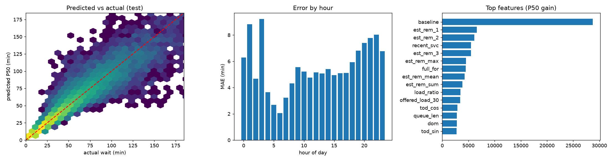

# EVspark wait-time model — evaluation report

> **IMPORTANT LIMITATION.** All numbers below are measured on labels produced by a queue simulator driven by real ACN-Data arrival sequences re-timed with ASSUMED Indian demand profiles, vehicle mix and charger types. ACN-Data has no queue/waiting labels. These results show the pipeline and model learn queue and rush-hour behaviour; they are NOT evidence of real-world accuracy at Indian stations. Re-train on real operator logs when available.

Test rows: 23,460 (all-chargers-busy arrivals from 2019-09-30+val split, test = after 2019-11-30). Estimated-remaining-time noise sigma = 0.15.

## Acceptance gate

- FAIL — accuracy (within max(5 min, 20%)) >= 0.88
- PASS — long-wait precision >= 0.88
- PASS — P80 coverage in (0.77, 0.83)
- PASS — ML MAE <= baseline MAE
- PASS — ML MAE at least 10% better than baseline

## Headline metrics (test)

|               |         n |   MAE |   MedAE |   RMSE |   bias |    R2 |   sMAPE |   within_tol |   within_5min |   within_10min |
|:--------------|----------:|------:|--------:|-------:|-------:|------:|--------:|-------------:|--------------:|---------------:|
| LightGBM P50  | 23460.000 | 5.713 |   2.279 | 12.140 | -0.406 | 0.897 |   0.130 |        0.868 |         0.712 |          0.853 |
| Baseline only | 23460.000 | 7.223 |   2.411 | 15.494 |  2.971 | 0.832 |   0.144 |        0.832 |         0.690 |          0.826 |

MAE improvement vs baseline: **20.9%** | P80 coverage: **0.781** | P90 coverage: **0.891**

## Long-wait alert (wait > 15 min)

|               |   value |
|:--------------|--------:|
| threshold     |   0.003 |
| positive_rate |   0.732 |
| precision     |   0.887 |
| recall        |   1.000 |
| f1            |   0.940 |
| pr_auc        |   0.998 |
| roc_auc       |   0.996 |

## Robustness to live-estimate noise (model trained at the fixed sigma)

|   sigma |   ML_within_tol |   ML_MAE |   baseline_within_tol |   baseline_MAE |
|--------:|----------------:|---------:|----------------------:|---------------:|
|   0.100 |           0.914 |    4.969 |                 0.886 |          6.358 |
|   0.150 |           0.866 |    5.729 |                 0.831 |          7.236 |
|   0.250 |           0.753 |    7.243 |                 0.711 |          8.907 |
|   0.400 |           0.624 |    9.456 |                 0.586 |         11.267 |

## By rush_phase

|   rush_phase |        n |   MAE |   MedAE |   RMSE |   bias |    R2 |   sMAPE |   within_tol |   within_5min |   within_10min |
|-------------:|---------:|------:|--------:|-------:|-------:|------:|--------:|-------------:|--------------:|---------------:|
|        0.000 | 1134.000 | 7.095 |   2.780 | 14.095 | -0.532 | 0.887 |   0.133 |        0.856 |         0.646 |          0.810 |
|        1.000 | 4413.000 | 4.758 |   1.924 | 10.623 | -0.474 | 0.901 |   0.122 |        0.889 |         0.758 |          0.888 |
|        2.000 | 7094.000 | 5.063 |   2.130 | 11.166 | -0.481 | 0.905 |   0.128 |        0.881 |         0.745 |          0.880 |
|        3.000 | 9441.000 | 6.180 |   2.441 | 12.828 | -0.375 | 0.892 |   0.133 |        0.856 |         0.688 |          0.833 |
|        4.000 | 1378.000 | 7.774 |   3.196 | 14.661 |  0.084 | 0.878 |   0.142 |        0.829 |         0.613 |          0.768 |

## By is_weekend

|   is_weekend |         n |   MAE |   MedAE |   RMSE |   bias |    R2 |   sMAPE |   within_tol |   within_5min |   within_10min |
|-------------:|----------:|------:|--------:|-------:|-------:|------:|--------:|-------------:|--------------:|---------------:|
|        0.000 | 14577.000 | 5.856 |   2.241 | 12.280 | -0.432 | 0.898 |   0.132 |        0.864 |         0.707 |          0.845 |
|        1.000 |  8883.000 | 5.477 |   2.366 | 11.907 | -0.365 | 0.895 |   0.126 |        0.875 |         0.721 |          0.866 |

## By is_holiday

|   is_holiday |         n |   MAE |   MedAE |   RMSE |   bias |    R2 |   sMAPE |   within_tol |   within_5min |   within_10min |
|-------------:|----------:|------:|--------:|-------:|-------:|------:|--------:|-------------:|--------------:|---------------:|
|        0.000 | 22380.000 | 5.714 |   2.279 | 12.138 | -0.414 | 0.897 |   0.130 |        0.869 |         0.712 |          0.852 |
|        1.000 |  1080.000 | 5.673 |   2.301 | 12.171 | -0.247 | 0.888 |   0.127 |        0.862 |         0.719 |          0.862 |

## By station_type

| station_type   |    n |   MAE |   MedAE |   RMSE |   bias |    R2 |   sMAPE |   within_tol |   within_5min |   within_10min |
|:---------------|-----:|------:|--------:|-------:|-------:|------:|--------:|-------------:|--------------:|---------------:|
| highway        | 9497 | 2.504 |   1.483 |  4.091 | -0.167 | 0.939 |   0.112 |        0.934 |         0.865 |          0.969 |
| mall           | 6389 | 7.875 |   3.615 | 15.143 | -0.553 | 0.875 |   0.140 |        0.819 |         0.589 |          0.768 |
| office         | 3577 | 6.749 |   2.641 | 13.758 | -0.803 | 0.887 |   0.138 |        0.845 |         0.666 |          0.814 |
| residential    | 3997 | 8.951 |   3.551 | 17.009 | -0.386 | 0.869 |   0.149 |        0.812 |         0.588 |          0.747 |

## By charger_type

| charger_type   |    n |   MAE |   MedAE |   RMSE |   bias |    R2 |   sMAPE |   within_tol |   within_5min |   within_10min |
|:---------------|-----:|------:|--------:|-------:|-------:|------:|--------:|-------------:|--------------:|---------------:|
| AC_3.3         | 5100 | 8.006 |   3.031 | 16.694 | -1.330 | 0.861 |   0.151 |        0.811 |         0.625 |          0.779 |
| AC_7.4         | 6429 | 9.454 |   4.407 | 16.744 | -0.017 | 0.871 |   0.146 |        0.804 |         0.535 |          0.713 |
| DC_30          | 5667 | 3.542 |   2.118 |  5.624 | -0.332 | 0.928 |   0.114 |        0.905 |         0.770 |          0.928 |
| DC_60          | 6264 | 1.969 |   1.246 |  2.952 | -0.121 | 0.937 |   0.111 |        0.948 |         0.913 |          0.988 |

## By n_chargers

|   n_chargers |        n |   MAE |   MedAE |   RMSE |   bias |    R2 |   sMAPE |   within_tol |   within_5min |   within_10min |
|-------------:|---------:|------:|--------:|-------:|-------:|------:|--------:|-------------:|--------------:|---------------:|
|        2.000 | 3946.000 | 8.316 |   3.032 | 17.974 | -0.944 | 0.871 |   0.145 |        0.831 |         0.633 |          0.787 |
|        3.000 | 7624.000 | 5.419 |   2.238 | 11.510 | -0.229 | 0.897 |   0.128 |        0.875 |         0.723 |          0.870 |
|        4.000 | 4013.000 | 6.478 |   2.736 | 12.630 | -1.023 | 0.892 |   0.134 |        0.844 |         0.666 |          0.817 |
|        6.000 | 6183.000 | 3.553 |   1.601 |  7.208 | -0.052 | 0.922 |   0.120 |        0.908 |         0.818 |          0.920 |
|        8.000 | 1694.000 | 7.041 |   3.937 | 11.167 |  0.214 | 0.905 |   0.132 |        0.838 |         0.573 |          0.770 |

## By queue_bucket

| queue_bucket   |    n |   MAE |   MedAE |   RMSE |   bias |    R2 |   sMAPE |   within_tol |   within_5min |   within_10min |
|:---------------|-----:|------:|--------:|-------:|-------:|------:|--------:|-------------:|--------------:|---------------:|
| 0              | 8909 | 2.628 |   1.250 |  4.933 | -0.152 | 0.967 |   0.122 |        0.937 |         0.855 |          0.955 |
| 1              | 6699 | 7.087 |   2.666 | 15.677 | -0.452 | 0.854 |   0.135 |        0.849 |         0.684 |          0.826 |
| 2              | 3912 | 7.818 |   3.534 | 14.525 | -0.614 | 0.861 |   0.136 |        0.811 |         0.600 |          0.780 |
| 3+             | 3940 | 8.260 |   4.269 | 13.969 | -0.696 | 0.869 |   0.134 |        0.803 |         0.549 |          0.740 |

