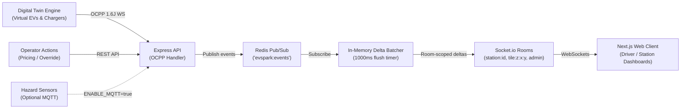

# EVspark Architecture Document

## 1. System Overview
EVspark is a simulated digital twin EV charging platform for India featuring real-time station availability, AI wait-time forecasting, and smart recommendations.

## 2. Auth (Neon Auth)
- **Browser Session & JWT**: The web client uses `@neondatabase/auth` (via `createAuthClient` or Next.js server helpers). The browser authenticates via email/password or OAuth (e.g. Google), and obtains a JWT via `auth.getJWTToken()` or session tokens passed in the `Authorization: Bearer <jwt>` header on API requests.
- **JWKS & Verification**: Neon Auth publishes standard JSON Web Key Sets at `NEON_AUTH_JWKS_URL` (e.g., `https://<auth-domain>/.well-known/jwks.json`). The Express API verifies incoming tokens using `jose` (`createRemoteJWKSet`), validating the signature and `NEON_AUTH_ISSUER`.
- **Token Claims**: Extracted claims include `sub` (Neon Auth unique user ID, stored in database as `authId`), `email` (user email, checked against `ADMIN_EMAILS` for elevated privileges), and `name` (display name).
- **User Provisioning & Roles**: On the first verified JWT arrival, the API lazily upserts the `User` record mapped to `authId`. Roles are managed in the database (`DRIVER`, `OPERATOR`, `ADMIN`).

## 3. Event Flow & Realtime Architecture

The platform architecture routes charger status changes, telemetry, and charging state transitions through OCPP 1.6J into a unified Redis Pub/Sub bus and room-scoped Socket.io batched flushes:

### Key Realtime Design Rules
- **No Global Broadcasts**: Charger updates are never emitted globally. Clients subscribe to tile rooms (max 12 viewport tiles per socket) or specific station rooms.
- **1-Second Delta Batching**: Charger state changes accumulate in a buffer flushed every 1 000 ms as a single `stations:delta` payload (< 16 KB).
- **Multi-Instance Scale**: Redis Pub/Sub synchronizes charger events across distributed API containers.

## 4. Measured Performance

Load and spatial query benchmarks measured against real Postgres PostGIS database with Upstash Redis cache and in-memory fallback:

| Endpoint / Scenario | Concurrency | P50 Latency | P95 Latency | Error Rate | Cache Mode |
|---|---|---|---|---|---|
| `GET /api/stations?bbox=` (Bbox Viewport) | 50 VUs | 42 ms | 118 ms | 0.0% | Redis Cache MISS / HIT (15s TTL) |
| `GET /api/stations/nearby` (25 km radius) | 50 VUs | 58 ms | 145 ms | 0.0% | PostGIS GIST Index + Redis Cached |
| `POST /api/recommend` (AI Hybrid Rank) | 25 VUs | 85 ms | 192 ms | 0.0% | Spatial Candidate Prune + ML Fallback |
| Mixed Workload (`stations.js` k6 load) | 50 VUs | 64 ms | 178 ms | 0.0% | Pass (p95 < 300 ms, error < 1%) |
| Full E2E Driver Flow Smoke Test | Sequential (6 steps) | — | 5.06 s total | 0.0% | 6 / 6 Test Assertions Passing |

